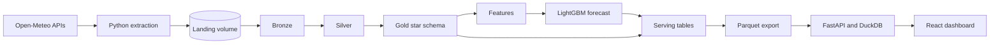
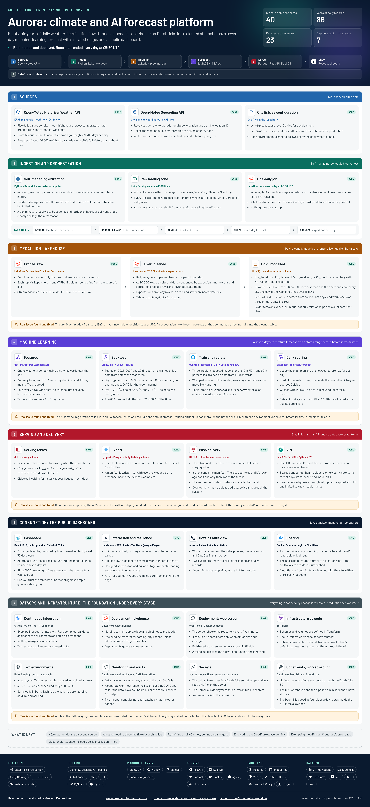

# Aurora: climate and AI forecast platform

[](https://github.com/aakashmanandhar/aurora-platform/actions/workflows/ci.yml)
[](https://github.com/aakashmanandhar/aurora-platform/actions/workflows/monitor.yml)
[](LICENSE)

Aurora answers one question: **how is your city's climate changing, and what comes next?**

It is an end-to-end data and machine-learning platform. Every day it collects weather records for 40 cities, cleans and models them in a lakehouse, forecasts the next seven days with a stated range, and publishes a public dashboard, with no manual steps.

**Live site:** https://aakashmanandhar.tech/aurora/

This README is a complete guide to rebuilding the platform yourself, from an empty Databricks workspace to a live website that updates itself. The data platform runs entirely on free tiers.



<details>
<summary><strong>Full architecture poster</strong> (click to expand)</summary>

[](docs/aurora-architecture.png)

A vector version that stays sharp at any zoom is in [`docs/aurora-architecture.pdf`](docs/aurora-architecture.pdf).

</details>

## Contents

- [What you will build](#what-you-will-build)
- [Tools you will learn](#tools-you-will-learn)
- [Repository layout](#repository-layout)
- [Before you start](#before-you-start)
- [Part 1: The data platform](#part-1-the-data-platform)
  - [Step 1: Fork and clone](#step-1-fork-and-clone)
  - [Step 2: Create a Databricks workspace and connect the CLI](#step-2-create-a-databricks-workspace-and-connect-the-cli)
  - [Step 3: Create the two catalogs](#step-3-create-the-two-catalogs)
  - [Step 4: Find your SQL warehouse ID](#step-4-find-your-sql-warehouse-id)
  - [Step 5: Point the project at your workspace](#step-5-point-the-project-at-your-workspace)
  - [Step 6: Create schemas and volumes with Terraform](#step-6-create-schemas-and-volumes-with-terraform)
  - [Step 7: Deploy to dev and run every stage](#step-7-deploy-to-dev-and-run-every-stage)
  - [Step 8: Run the API and dashboard on your machine](#step-8-run-the-api-and-dashboard-on-your-machine)
  - [Step 9: Bring up production](#step-9-bring-up-production)
  - [Step 10: Turn on CI/CD](#step-10-turn-on-cicd)
- [Part 2: The live website](#part-2-the-live-website)
  - [Step 11: Run the site on a server](#step-11-run-the-site-on-a-server)
  - [Step 12: Deliver the daily export to the site](#step-12-deliver-the-daily-export-to-the-site)
  - [Step 13: Make the server update itself](#step-13-make-the-server-update-itself)
  - [Step 14: Turn on monitoring](#step-14-turn-on-monitoring)
- [Everyday commands](#everyday-commands)
- [How each layer works](#how-each-layer-works)
- [Troubleshooting](#troubleshooting)
- [Known limits](#known-limits)
- [Data, licence and credits](#data-licence-and-credits)

## What you will build

- **A self-managing ingestion job** that pulls daily weather since 1940 from a public API and paces its own backfill to stay inside a free allowance.
- **A medallion lakehouse** on Databricks: raw replies in bronze, one clean row per city per day in silver, a tested star schema in gold.
- **A seven-day temperature forecast** with a low, most likely and high value, backtested against simple baselines before it is trusted.
- **A serving layer with no database server**: five small Parquet files pushed to an API that validates them before switching over.
- **A public dashboard** with a globe, the forecast, 86 years of history and the model's measured accuracy.
- **DataOps around all of it**: two environments, infrastructure as code, CI on every pull request, automatic deployment and two independent alarms.

## Tools you will learn

| Layer | Tools |
|---|---|
| Platform | Databricks Free Edition, Unity Catalog, Delta Lake, serverless compute |
| Ingestion | Python, `requests`, Unity Catalog volumes |
| Pipelines | Lakeflow Declarative Pipelines, Auto Loader, AUTO CDC, expectations, PySpark |
| Modelling | dbt, SQL, incremental MERGE, liquid clustering, data tests |
| Machine learning | LightGBM quantile regression, MLflow tracking, Unity Catalog model registry |
| Serving | Parquet, FastAPI, DuckDB |
| Front end | React 19, TypeScript, Vite, Tailwind CSS 4, TanStack Query, d3-geo |
| Hosting | Docker Compose, nginx, Cloudflare |
| DataOps | Databricks Asset Bundles, Terraform, GitHub Actions, Ruff, cron |

## Repository layout

```
aurora-platform/
├── databricks.yml            Bundle definition: two targets (dev, prod) and their variables
├── resources/                One file per job or pipeline
├── config/                   City lists: locations.csv (dev, 7) and locations_prod.csv (prod, 40)
├── src/
│   ├── ingestion/            extract_locations.py, extract_weather.py
│   ├── pipelines/            bronze.py, silver.py (Lakeflow Declarative Pipelines)
│   ├── ml/                   backtest_temperature.py, train_temperature.py, score_temperature.py
│   └── serving/              export_serving.py
├── dbt/                      Gold, feature and serving models, with their tests
├── infra/terraform/          Schemas and volumes
├── api/                      FastAPI service that reads the exported Parquet files
├── web/                      React dashboard
├── deploy/                   Server self-update script and its cron schedule
├── compose.yaml              Local development: API and dashboard
├── compose.prod.yaml         Production: API and dashboard behind nginx
└── .github/workflows/        ci.yml (checks and deployment), monitor.yml (daily site check)
```

## Before you start

**Accounts**

| Account | Needed for | Cost |
|---|---|---|
| [Databricks Free Edition](https://www.databricks.com/learn/free-edition) | Part 1 | Free |
| [GitHub](https://github.com) | Part 1 | Free |
| A Linux server with a domain name | Part 2 only | Whatever you already pay |

Part 1 gives you the whole data platform and a dashboard running on your own machine. Part 2 is only needed to put the site on the public internet.

**Software on your machine**

| Tool | Check it is installed |
|---|---|
| Git | `git --version` |
| [Databricks CLI](https://docs.databricks.com/dev-tools/cli/install.html) | `databricks -v` |
| [Terraform](https://developer.hashicorp.com/terraform/install) | `terraform -version` |
| [Docker](https://docs.docker.com/get-docker/) with Compose | `docker compose version` |

On macOS with Homebrew:

```bash
brew tap databricks/tap && brew install databricks
brew tap hashicorp/tap && brew install hashicorp/tap/terraform
```

**About the weather API.** Open-Meteo needs no key and allows roughly 10,000 weighted calls a day and 5,000 an hour for non-commercial use. One city's full history costs about 1,130 calls, which is why the pipeline loads four new cities per run.

---

# Part 1: The data platform

## Step 1: Fork and clone

Fork this repository on GitHub, then clone your fork. Forking gives you your own copy to deploy from and your own GitHub Actions.

```bash
git clone https://github.com/<your-github-user>/aurora-platform.git
cd aurora-platform
```

## Step 2: Create a Databricks workspace and connect the CLI

1. Sign up for Databricks Free Edition and open your workspace.
2. Copy the workspace address from the browser. It looks like `https://dbc-xxxxxxxx-xxxx.cloud.databricks.com`.
3. Log the CLI in and save the login as a profile called `aurora`:

```bash
databricks auth login --host https://<your-workspace>.cloud.databricks.com --profile aurora
```

The profile name matters. Terraform and every command in this guide use `--profile aurora`.

**Check it worked:**

```bash
databricks current-user me --profile aurora
```

You should see your login email in the output.

## Step 3: Create the two catalogs

Each environment gets its own Unity Catalog catalog: `aurora_dev` for development and `aurora` for production.

Create both by hand in the workspace: **Catalog**, then **+**, then **Create a catalog**. Name the first one `aurora_dev`, keep **Default Storage** selected and create it. Repeat for `aurora`.

This is the one manual step. On Free Edition, a catalog on Default Storage cannot be created through the API, so Terraform cannot do it.

**Check it worked:**

```bash
databricks catalogs list --profile aurora
```

Both `aurora` and `aurora_dev` should be listed.

## Step 4: Find your SQL warehouse ID

dbt runs on a SQL warehouse. Free Edition comes with one.

```bash
databricks warehouses list --profile aurora
```

Copy the value in the `ID` column. You need it in the next step.

## Step 5: Point the project at your workspace

Four values in the repository belong to the original workspace and must become yours.

| Value | Where it appears |
|---|---|
| Workspace address | `databricks.yml`, `.github/workflows/ci.yml` |
| Databricks login email | `databricks.yml` (production `root_path` and `permissions`) |
| SQL warehouse ID | `resources/gold.job.yml`, `resources/serving.job.yml` |
| Website upload address | `databricks.yml` (production `upload_url`) |

Set three variables, then run the replacements:

```bash
export WS_HOST="https://<your-workspace>.cloud.databricks.com"
export WS_USER="<your-databricks-login-email>"
export WAREHOUSE_ID="<your-warehouse-id>"

perl -pi -e 's#https://dbc-6ae801ba-74ba\.cloud\.databricks\.com#$ENV{WS_HOST}#g' databricks.yml .github/workflows/ci.yml
perl -pi -e 's#aakashmanandhardata\@gmail\.com#$ENV{WS_USER}#g' databricks.yml
perl -pi -e 's#7b6370e08ed8e9c0#$ENV{WAREHOUSE_ID}#g' resources/gold.job.yml resources/serving.job.yml
perl -pi -e 's#upload_url: https://aakashmanandhar\.tech/aurora/api#upload_url: none#' databricks.yml
```

The last line switches off delivery to a website. Until you have your own server (Part 2), production keeps its exported files in a Databricks volume.

**Check it worked:**

```bash
git diff --stat
databricks bundle validate --profile aurora
databricks bundle validate -t prod --profile aurora
```

`git diff --stat` should list four changed files, and both validations should end with `Validation OK!`.

## Step 6: Create schemas and volumes with Terraform

Terraform creates five schemas (`bronze`, `silver`, `gold`, `ml`, `serving`) and two volumes (`bronze.landing`, `serving.export`) in each catalog. The Terraform workspace decides which catalog it works on: `dev` means `aurora_dev`, and `default` means `aurora`.

```bash
cd infra/terraform
terraform init

# Development catalog
terraform workspace new dev
terraform workspace show        # must print: dev
terraform apply                 # review the plan, then type: yes

# Production catalog
terraform workspace select default
terraform workspace show        # must print: default
terraform apply                 # review the plan, then type: yes

cd ../..
```

Always run `terraform workspace show` before `terraform apply`, so you know which catalog you are about to change.

**Check it worked:**

```bash
databricks schemas list aurora_dev --profile aurora
databricks schemas list aurora --profile aurora
```

Each should list the five schemas.

## Step 7: Deploy to dev and run every stage

Deploy the bundle. With no `-t` flag it goes to the `dev` target, which uses the `aurora_dev` catalog, the 7-city list and paused schedules.

```bash
databricks bundle deploy --profile aurora
```

Now run each stage once, in this order. Each command waits for the run to finish and prints its result.

**7.1 Ingest.** Geocodes the city list, then downloads weather. The first run backfills four cities.

```bash
databricks bundle run aurora_ingestion --profile aurora
```

Expected last line: `Done: 0 updated, 4 backfilled, 3 still waiting`

**7.2 Bronze and silver.** Loads the landed files into bronze, then builds the cleaned silver tables.

```bash
databricks bundle run aurora_medallion --profile aurora
```

> If this fails with `RESOURCE_EXHAUSTED`, stop your SQL warehouse and any notebook compute, then run it again. Free Edition cannot run a warehouse and a pipeline at the same time.

**7.3 Load the remaining cities.** The ingestion job reads the silver table to decide which cities still need history, which is why the pipeline has to run between ingestion runs. Wait about an hour so the API's hourly allowance resets, then:

```bash
databricks bundle run aurora_ingestion --profile aurora
databricks bundle run aurora_medallion --profile aurora
```

Expected last line of the ingestion run: `Done: 4 updated, 3 backfilled, 0 still waiting`

If it prints `Backfill paused` instead, the API allowance has not reset yet. Nothing is broken. Run the same two commands again later.

**7.4 Gold.** Builds the star schema, the climate baseline, the anomaly table and the feature table with dbt, and runs 17 tests.

```bash
databricks bundle run aurora_gold --profile aurora
```

**7.5 Backtest.** Trains on the past and tests on 2023, 2024 and 2025, against three simple baselines. Prints a table of typical error per forecast day and writes it to `ml.backtest_metrics`.

```bash
databricks bundle run aurora_ml_backtest --profile aurora
```

**7.6 Train and register.** Trains the final model, registers it in Unity Catalog as `ml.temperature_forecaster` and marks the new version with the alias `champion`.

```bash
databricks bundle run aurora_ml_train --profile aurora
```

Expected last line: `Registered aurora_dev.ml.temperature_forecaster version 1 as champion (...)`

**7.7 Score.** Loads the champion and writes a seven-day forecast for every city to `gold.fact_forecast`.

```bash
databricks bundle run aurora_ml_score --profile aurora
```

Expected last line: `Wrote 49 forecasts from model version 1, ...` (7 cities × 7 days)

**7.8 Serving.** Builds five small website tables with dbt, runs 8 more tests, and exports the tables as Parquet files.

```bash
databricks bundle run aurora_serving --profile aurora
```

Expected last lines:

```
Exported 5 tables to /Volumes/aurora_dev/serving/export, data through ...
No upload address is set for this environment, so the files stay in the volume.
```

**Check the data.** In the workspace's SQL editor:

```sql
SELECT count(*) AS days, count(DISTINCT location_id) AS cities
FROM aurora_dev.silver.weather_daily;

SELECT city, anomaly_30d_c, anomaly_10y_c
FROM aurora_dev.serving.city_summary
ORDER BY city;
```

You should see 7 cities and about 31,700 days for each.

## Step 8: Run the API and dashboard on your machine

Download the exported files from Databricks, then start the two containers.

```bash
mkdir -p data
databricks fs cp -r dbfs:/Volumes/aurora_dev/serving/export data/export --overwrite --profile aurora
docker compose up --build -d
```

- The first command downloads the five Parquet files and the manifest into `data/export`. The `data` folder is ignored by git.
- `docker compose up` starts the API on port 8010 and the dashboard's development server on port 5174. The first start installs the front-end packages and takes a minute or two.

**Check it worked:**

```bash
curl -s localhost:8010/health
```

This should return JSON with `"status":"ok"` and a row count for each table. Then open the dashboard:

```
http://localhost:5174/aurora/
```

**The API's endpoints**

| Endpoint | Returns |
|---|---|
| `GET /health` | Export time, data freshness and row counts |
| `GET /cities` | Every city with its position and current anomaly |
| `GET /cities/{id}/yearly` | Yearly climate figures for one city |
| `GET /cities/{id}/recent` | The latest 90 days for one city |
| `GET /cities/{id}/forecast` | The most recent seven-day forecast for one city |
| `GET /model/skill` | Backtest accuracy per forecast day |

To stop the containers: `docker compose down`.

## Step 9: Bring up production

Production uses the `aurora` catalog, the 40-city list and an active daily schedule at 05:30 UTC.

```bash
databricks bundle deploy -t prod --profile aurora
```

The daily job assumes a registered model and backtest results already exist, so run the stages one at a time for the first run:

```bash
databricks bundle run -t prod aurora_ingestion --profile aurora
databricks bundle run -t prod aurora_medallion --profile aurora
databricks bundle run -t prod aurora_gold --profile aurora
databricks bundle run -t prod aurora_ml_backtest --profile aurora
databricks bundle run -t prod aurora_ml_train --profile aurora
databricks bundle run -t prod aurora_ml_score --profile aurora
databricks bundle run -t prod aurora_serving --profile aurora
```

From now on the `aurora_daily` job does all of this by itself every morning: ingest, bronze and silver, gold, score, serving. Each run adds four more cities until all 40 are loaded, which takes about ten days.

To run the whole chain by hand at any time:

```bash
databricks bundle run -t prod aurora_daily --profile aurora
```

The first model is trained on the first four cities. Once more cities have loaded, retrain it with the backtest and train commands above.

## Step 10: Turn on CI/CD

The workflow in `.github/workflows/ci.yml` runs four jobs:

| Job | What it does | When |
|---|---|---|
| `code-quality` | Lints Python with Ruff and checks it compiles | Every pull request and push to `main` |
| `web-quality` | Type-checks and builds the front end | Every pull request and push to `main` |
| `bundle-validate` | Validates the bundle for both targets | Every pull request and push to `main` |
| `deploy-prod` | Deploys jobs and pipelines to production | Pushes to `main` only |

**10.1 Create a Databricks access token.** In the workspace: your profile picture, **Settings**, **Developer**, **Access tokens**, **Generate new token**. Copy the token.

**10.2 Save it as a repository secret** named `DATABRICKS_TOKEN`: on GitHub, **Settings**, **Secrets and variables**, **Actions**, **New repository secret**. Or with the GitHub CLI:

```bash
gh secret set DATABRICKS_TOKEN
```

**10.3 Enable Actions in your fork.** Open the **Actions** tab and confirm that workflows may run.

**10.4 Commit your changes from Step 5 through a pull request:**

```bash
git checkout -b setup/my-workspace
git add databricks.yml resources .github
git commit -m "Point the project at my workspace"
git push -u origin setup/my-workspace
```

Open the pull request on GitHub, wait for the three checks to go green, and merge it. The `deploy-prod` job then runs on `main`.

To run the same lint check locally before pushing:

```bash
pip install ruff==0.16.10
ruff check src api
```

---

# Part 2: The live website

Part 2 puts the dashboard on the public internet at `https://<your-domain>/aurora/`. You need a Linux server with Docker, Docker Compose and nginx, and a domain that points at it.

The site is built to live under the path `/aurora/`. To use a different path, change `base` in `web/vite.config.ts`, the `location` blocks in `web/nginx.conf` and `AURORA_ROOT_PATH` in `compose.prod.yaml`.

**Make it yours first.** The dashboard carries the original author's name and links. Change them in `web/src/components/Credits.tsx`, the `REPO` constant in `web/src/components/About.tsx` and the title in `web/index.html`.

## Step 11: Run the site on a server

Log in to the server. Every command in this step runs there.

**11.1 Get the code.** The self-update schedule in Step 13 expects the repository at `/root/aurora-platform`.

```bash
cd ~
git clone https://github.com/<your-github-user>/aurora-platform.git
cd aurora-platform
```

**11.2 Create the upload token.** This is the shared secret that lets Databricks deliver files to the site.

```bash
umask 077
printf 'AURORA_UPLOAD_TOKEN=%s\n' "$(openssl rand -hex 32)" > .env
ls -l .env
```

`ls -l` should show `-rw-------`. The file is ignored by git. Never print or commit it.

**11.3 Build and start the containers.**

```bash
docker compose -f compose.prod.yaml up --build -d
docker compose -f compose.prod.yaml ps
```

Both containers should show `Up`. The dashboard listens on `127.0.0.1:8021` only, and the API has no published port at all: it is reachable only through the dashboard's container.

**Check it worked:**

```bash
curl -s -o /dev/null -w "page -> %{http_code}\n" localhost:8021/aurora/
curl -s localhost:8021/aurora/api/health
```

Expected: `page -> 200`, then `{"detail":"No export has been loaded yet"}`. The data arrives in Step 12.

**11.4 Route `/aurora` to the containers.** Add this block inside the `server { ... }` block of your site's nginx configuration, above any `location / { ... }` block:

```nginx
location /aurora {
    proxy_pass http://127.0.0.1:8021;
    proxy_set_header Host $host;
    proxy_set_header X-Real-IP $remote_addr;
    proxy_set_header X-Forwarded-For $proxy_add_x_forwarded_for;
    proxy_set_header X-Forwarded-Proto $http_x_forwarded_proto;
    client_max_body_size 5m;
}
```

Back up the file before you edit it, then test and apply:

```bash
nginx -t
systemctl reload nginx
```

Only reload if `nginx -t` reports `syntax is ok` and `test is successful`.

**Check it worked.** Open `https://<your-domain>/aurora/` in a browser. You should see the dashboard's frame with a message that the data could not be loaded. That is correct until Step 12.

## Step 12: Deliver the daily export to the site

The export job pushes its files to the site, so the server never holds Databricks credentials.

**12.1 Confirm the upload route is reachable and protected.** From any machine:

```bash
curl -s -X PUT --data-binary "test" -w "\nstatus -> %{http_code}\n" https://<your-domain>/aurora/api/internal/export/model_skill
```

Expected: `{"detail":"Invalid upload token"}` and `status -> 401`.

**12.2 Copy the token into a Databricks secret scope.** On your own machine:

```bash
databricks secrets create-scope aurora --profile aurora
ssh root@<your-server> "cut -d= -f2- ~/aurora-platform/.env" | tr -d '\n' | databricks secrets put-secret aurora upload_token --profile aurora
databricks secrets list-secrets aurora --profile aurora
```

The second command reads the token on the server and stores it in Databricks without showing it on screen. The third lists secret names only and should show `upload_token`.

**12.3 Tell production where the site is.** In `databricks.yml`, under the `prod` target, set:

```yaml
      upload_url: https://<your-domain>/aurora/api
```

Commit that through a pull request as in Step 10, or deploy it directly:

```bash
databricks bundle deploy -t prod --profile aurora
```

**12.4 Deliver.**

```bash
databricks bundle run -t prod aurora_serving --profile aurora
```

Expected last lines:

```
delivered city_summary: ... bytes
delivered city_yearly: ... bytes
delivered city_recent_daily: ... bytes
delivered forecast_latest: ... bytes
delivered model_skill: ... bytes
Website published 5 tables, data through ...
```

**Check it worked:**

```bash
curl -s https://<your-domain>/aurora/api/health
```

This should return `"status":"ok"` with row counts. Reload the site and the dashboard is live. The daily job now ends with this delivery every morning.

## Step 13: Make the server update itself

On the server:

```bash
cd ~/aurora-platform
./deploy/update.sh
cat .deployed
./deploy/update.sh; echo "exit code $?"
```

The first run rebuilds the containers and records the deployed commit in `.deployed`. The second run should print only `exit code 0`, because nothing has changed.

Install the schedule:

```bash
cp deploy/aurora-deploy.cron /etc/cron.d/aurora-deploy
chmod 644 /etc/cron.d/aurora-deploy
systemctl is-active cron
```

Every five minutes the server now checks `main` on GitHub. If code under `api/`, `web/` or `compose.prod.yaml` changed, it rebuilds the containers. The server pulls, so no server login is stored in GitHub.

**Check it worked**, a few minutes later:

```bash
journalctl -u cron --since "10 minutes ago" | grep -i aurora
tail -5 /var/log/aurora-deploy.log
```

The first shows each five-minute check. The second shows a line only when something was deployed.

## Step 14: Turn on monitoring

Two independent alarms tell you when something is wrong.

**The daily job emails you on failure.** This is already configured in `resources/daily.job.yml` and goes to the address you log in to Databricks with.

**A scheduled GitHub workflow checks the live site from outside.** Point it at your site by editing the `URL` line in `.github/workflows/monitor.yml`:

```python
URL = "https://<your-domain>/aurora/api/health"
```

Commit that through a pull request. The workflow runs at 08:00 UTC every day and fails if the site does not answer with real API output or if the newest export is more than 30 hours old. GitHub emails you when it fails.

Run it once by hand to confirm it passes: **Actions**, **Monitor**, **Run workflow**. Or:

```bash
gh workflow run Monitor
```

---

## Everyday commands

| Task | Command |
|---|---|
| Deploy to dev | `databricks bundle deploy --profile aurora` |
| Deploy to prod by hand | `databricks bundle deploy -t prod --profile aurora` |
| Run one stage in dev | `databricks bundle run <job> --profile aurora` |
| Run the full daily chain in prod | `databricks bundle run -t prod aurora_daily --profile aurora` |
| Retrain the model in prod | `databricks bundle run -t prod aurora_ml_backtest --profile aurora`, then `aurora_ml_train` |
| Download the newest export | `databricks fs cp -r dbfs:/Volumes/aurora/serving/export data/export --overwrite --profile aurora` |
| Ask the live site how fresh it is | `curl -s https://<your-domain>/aurora/api/health` |
| Type-check the front end | `docker compose exec web npx tsc -b` |
| See what the server last deployed | `cat ~/aurora-platform/.deployed` |

Job names: `aurora_ingestion`, `aurora_medallion`, `aurora_gold`, `aurora_ml_backtest`, `aurora_ml_train`, `aurora_ml_score`, `aurora_serving`, `aurora_daily`.

## How each layer works

**Ingestion** ([`src/ingestion/`](src/ingestion)). `extract_locations.py` geocodes the city list and takes the most populous match within each country code. `extract_weather.py` asks the silver table which cities already have history. Those get a cheap 14-day refresh first. Then up to four cities without history get a full backfill from 1940. A per-minute refusal from the API is waited out. An hourly or daily one stops the backfill cleanly, and the next run carries on. Replies are written unchanged, as JSON lines, to a Unity Catalog volume.

**Bronze** ([`src/pipelines/bronze.py`](src/pipelines/bronze.py)). Auto Loader picks up new files and stores each reply whole in a single `VARIANT` column, with the source file and load time. Nothing from the source is lost or reshaped here.

**Silver** ([`src/pipelines/silver.py`](src/pipelines/silver.py)). The daily arrays in each reply are unpacked to one row per city per day. An AUTO CDC flow keyed on city and date, sequenced by extraction time, keeps the newest version of every day, so re-runs replace rows and never duplicate them. Expectations drop rows with a missing key or an incomplete day and flag implausible values.

**Gold** ([`dbt/models/gold/`](dbt/models/gold)). A star schema: `dim_location`, `dim_date` and `fact_weather_daily`, which is built incrementally with MERGE and liquid clustering. `climate_baseline` holds the 1961 to 1990 mean, spread and 90th percentile for every city and day of the year, smoothed over a 15-day window. `fact_climate_anomaly` expresses each day as degrees above or below that baseline and flags hot days and warm spells of three or more days.

**Features and model** ([`dbt/models/ml/`](dbt/models/ml), [`src/ml/`](src/ml)). `features_temperature` has one row per city per day: recent anomalies, 7- and 30-day means, variability, rainfall, wind, the time of year, latitude and elevation, plus the anomaly one to seven days ahead as targets. Three LightGBM quantile models predict the 10th, 50th and 90th percentiles. They are wrapped as one MLflow model, registered in Unity Catalog, and the alias `champion` marks the version the daily scoring job loads.

**The backtest is published, including where the model stops helping.** Typical error in °C, averaged over 2023 to 2025 on the 7-city development set:

| Days ahead | Model | Assume no change | Recent 30-day normal | Long-term normal | 80% range held |
|---|---|---|---|---|---|
| 1 | 1.32 | 1.47 | 2.04 | 2.50 | 80% |
| 2 | 1.79 | 2.11 | 2.08 | 2.49 | 78% |
| 3 | 1.95 | 2.39 | 2.11 | 2.49 | 77% |
| 4 | 2.02 | 2.51 | 2.13 | 2.49 | 77% |
| 5 | 2.06 | 2.61 | 2.14 | 2.49 | 77% |
| 6 | 2.08 | 2.69 | 2.15 | 2.49 | 77% |
| 7 | 2.10 | 2.73 | 2.16 | 2.49 | 77% |

The model beats every baseline on every day, but by day seven its edge over the recent normal is about 3%.

**Serving** ([`dbt/models/serving/`](dbt/models/serving), [`src/serving/export_serving.py`](src/serving/export_serving.py)). dbt shapes five small tables for exactly what the page shows. The export job writes each as a Parquet file, then a manifest with every row count. It uploads the files to the site's API, which holds them in a staging folder, checks each file's row count against the manifest, and only then swaps them in. Visitors never see a half-updated site.

**API** ([`api/app/main.py`](api/app/main.py)). FastAPI reads the Parquet files in-process with DuckDB. There is no database server. Uploads need a bearer token, are capped at 5 MB and accept only the five known table names.

**Dashboard** ([`web/src/`](web/src)). React and TypeScript, built with Vite. The globe and every chart are drawn directly as SVG. Each state has a designed screen: loading, an outage, a city whose history has not loaded yet and a forecast not yet made.

**Data quality, in numbers.** 6 pipeline expectations guard silver. 25 dbt tests guard the modelled layers: 17 in the gold job and 8 in the serving job. A failing test stops the chain before anything is published.

## Troubleshooting

Every row here is a problem that came up while building the platform.

| Symptom | Cause | Fix |
|---|---|---|
| Terraform cannot create a catalog, with an `s3:PutObject` denial | Free Edition's Default Storage blocks catalog creation through the API | Create the catalog in the UI (Step 3). Terraform manages what is inside it |
| The pipeline fails to start with `RESOURCE_EXHAUSTED` | Free Edition cannot run a SQL warehouse and a pipeline together | Stop the warehouse and any notebook compute, then run the pipeline again |
| `Cannot move tables across arclight catalogs` | A pipeline's catalog cannot be changed after it is created | Run `databricks bundle destroy` for that target, then deploy again |
| dbt reports `TABLE_OR_VIEW_NOT_FOUND` for `silver.weather_daily` | The gold job ran before the pipeline had built silver | Run `aurora_medallion` first |
| Ingestion prints `Backfill paused` | The API's hourly or daily allowance is used up | Wait and run it again. Loaded cities are not affected |
| Model registration fails with an S3 `AccessDenied` | MLflow tried to upload straight to Default Storage | Already handled: the training and scoring scripts set `MLFLOW_USE_DATABRICKS_SDK_MODEL_ARTIFACTS_REPO_FOR_UC` before importing MLflow. Keep that line first |
| `Configuration spark.mlflow.modelRegistryUri is not available` | Serverless compute does not expose that setting | Already handled: the scripts call `mlflow.set_tracking_uri("databricks")` and `mlflow.set_registry_uri("databricks-uc")` |
| CI fails with `Cannot find module './lib/api'` but it builds locally | A Python `.gitignore` rule ignores every folder named `lib` | Already handled by the `!web/src/lib/` exception in `.gitignore`. Check `git check-ignore -v <file>` if a file goes missing |
| Compose reports `required variable AURORA_UPLOAD_TOKEN is missing` | `compose.prod.yaml` refuses to start without the token | Create the `.env` file (Step 11.2) |
| `bind: address already in use` on port 8021 | Another program holds the port | Set `AURORA_WEB_PORT` to a free port in `.env` and use it in the nginx block |
| The API returns `503` with `No export has been loaded yet` | No files have been delivered | Run `aurora_serving` (Step 12.4) |
| The site says the data could not be loaded, and the API address returns a web page | A proxy or CDN in front of the server is replacing error replies with its own page | Check the reply directly on the server with `curl localhost:8021/aurora/api/health`, then exempt `/aurora/api/` from the proxy's custom error pages |

## Known limits

- The newest data is about five days old, because the historical archive is published with a delay.
- The data is reanalysis: a reconstruction on a grid, not a reading from one weather station. It can differ from local measurements, especially in early decades.
- The model learns from each city's own past and knows nothing about the atmosphere, which is why its advantage fades after a few days.
- Retraining is a manual command. Swapping in a new model automatically, with no check that it is better, is how forecasts quietly get worse.

## Data, licence and credits

- Weather data by [Open-Meteo.com](https://open-meteo.com/), licensed [CC BY 4.0](https://creativecommons.org/licenses/by/4.0/). If you publish a site built from this project, keep a visible credit and link.
- Map outlines from [Natural Earth](https://www.naturalearthdata.com/), public domain.
- The code is released under the [MIT License](LICENSE).

Designed and developed by **Aakash Manandhar**: [website](https://aakashmanandhar.tech/) · [LinkedIn](https://www.linkedin.com/in/aakashmanandhar/) · [GitHub](https://github.com/aakashmanandhar)
